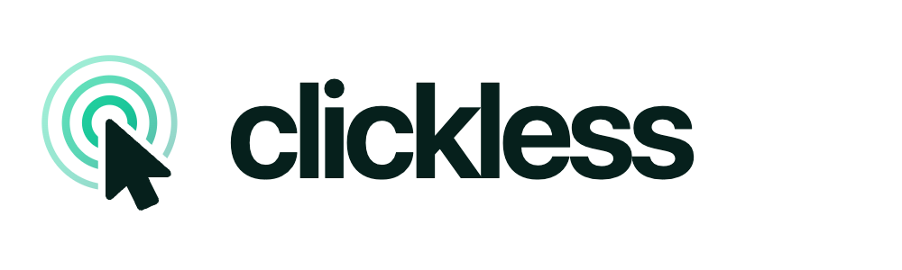

<p align="center">
  <picture>
    <source media="(prefers-color-scheme: dark)" srcset="assets/logo-dark.png">
    
  </picture>
</p>

# Clickless

**The AI-native open-source browser for everybody.**

Say it. It's done. Stop clicking through the web: tell Clickless what you want and it finds, fills, books and buys while you watch, with the AI you choose. Claude Code, a local model in LM Studio or Ollama, any API, or your own script: they all drive your real, signed-in browser in a few calls instead of dozens. Arc-style spaces and tabs for you, a control API built for agents, free and open source.

You can take over at any moment, and the agent hands back to you for logins and captchas, then carries on.

> Status: early preview (v0.1). macOS first; the code is cross-platform Electron but Windows/Linux builds aren't tested yet.

## Why another AI browser

Agent browsers today make the model work too hard. The usual loop is *screenshot → think → click one thing → screenshot again*, and every step is a round trip. Clickless is designed around the opposite idea: **each call should do a lot and tell you everything that changed.**

- **One `act` call, many steps.** "Open the page, fill six fields, tick two boxes, submit" is one call. It waits for the page to settle after each step and stops at the first failure with similar elements as suggestions.
- **The result is the next observation.** `act` returns each step's outcome, the new URL, text that appeared (errors, toasts), and either the changed elements or, on a new page, the full element list. On a page with almost nothing to click (a JSON response, a confirmation), it includes the page text. No "now look again" call.
- **Target by text, not only by number.** `click "Sign in"`, `type "Email" "me@x.com"`. Refs from `observe` (`[12]`) work too and stay stable across calls; if one goes stale, Clickless finds the element again by name.
- **Compact page model.** `observe` lists every link, button and field with its state, grouped by headings and landmarks, nav links folded onto one line, things behind a modal hidden. It reads cross-origin iframes and open shadow DOM.
- **Real input.** Clicks and keys are trusted events (Chrome DevTools Protocol), so they work on sites that ignore synthetic events. Date/time pickers, native selects, hidden custom checkboxes and file uploads are handled for the agent.
- **Search + read in one call.** `search` queries the web through the browser (no API key) and returns the top results already read as markdown.
- **Any agent.** MCP over HTTP, an stdio MCP bridge, a plain JSON API, tool schemas in OpenAI/Anthropic format for your own loop, an `clickless` CLI for shell agents, and an optional Chrome DevTools port for Playwright, Puppeteer or browser-use.

A real run: Claude Code (Sonnet) filled and submitted a pizza order form and got back the server's JSON in **one** `act` call:

```text
✓ 1. Opened https://httpbin.org/forms/post
✓ 2. Filled “Ada” into textbox “Customer name:” [1]; Set time “Preferred delivery time:” [2] to “19:30”; radio “Large” [3] checked; checkbox “Onion” [4] checked
✓ 3. Click button “Submit order” [5]

Now: “(untitled)” — https://httpbin.org/post (new page) · tab t2 · 3049ms
## Page text
{ "form": { "custname": "Ada", "delivery": "19:30", "size": "large", "topping": "onion" … } }
```

## For you: the browser

- **Spaces** with their own colour, pinned tabs and folders; **favourites** shared across spaces; **Today** tabs that archive themselves after 12 hours (configurable) and go to sleep when idle.
- **Command bar** (`⌘T`): open, search, switch to an open tab, find archived tabs and history, run commands. `Tab` switches it to **Ask AI**.
- **AI search** (`⌘J`): searches, reads the top pages and answers with numbered citations, with follow-ups. Works with any model you configure.
- **Agent panel** (`⌘E`): chat with an agent about the page or give it a task. You see every step, and an animated cursor and highlight on the page while it works. Pause or stop any agent at any time (`⌘.`).
- **Tidy tabs** (`⇧⌘O`): groups Today's tabs into named folders and suggests closing duplicates.
- Split view, find in page, downloads, per-site permissions, Arc-style keyboard shortcuts (`⌘S` sidebar, `⌘D` pin, `Ctrl+1…9` spaces, `⌘1…9` tabs).
- **Move in from Arc, Comet, Chrome, Brave or Edge** (Settings → Tabs, or `clickless import arc`): spaces, pinned tabs, folders, favourites and their icons from Arc; bookmarks and the tabs you had open from Chromium browsers. Run it again any time; nothing is duplicated. Passwords and logins are never read.

## Quick start

Requirements: Node 20.19+ and macOS (Apple silicon or Intel).

```bash
git clone https://github.com/antonarnaudov/clickless clickless && cd clickless
npm install
npm run dev
```

The first start opens a window and the control API on `http://127.0.0.1:7734`. The port and a random token are written to `~/.clickless/control.json` (only your user can read it).

Install it as an app: `npm run dist`, then move `release/mac-arm64/Clickless.app` into Applications. The build signs it ad-hoc (no Apple developer certificate yet), so it opens on the Mac that built it; on another Mac, right-click → Open the first time.

## Connect an agent

Settings → **Agents & API** shows every snippet below with your token filled in.

**Claude Code**

```bash
claude mcp add --scope user --transport http clickless http://127.0.0.1:7734/mcp --header "Authorization: Bearer <token>"
```

**Any MCP client** (Claude Desktop, Cursor, Windsurf, Zed, Codex, Cline…), stdio:

```json
{ "mcpServers": { "clickless": { "command": "node", "args": ["/path/to/clickless/dist/cli/clickless.js", "mcp"] } } }
```

or over HTTP: `{"type": "http", "url": "http://127.0.0.1:7734/mcp", "headers": {"Authorization": "Bearer <token>"}}`.

**Shell agents and scripts**: the CLI reads the token itself and starts Clickless if it isn't running.

```bash
npm link                     # puts `clickless` on your PATH
clickless act 'goto github.com/login; type Username "me"; type Password "…" enter'
clickless observe --query "price|add to cart"
clickless read --query "shipping"
clickless search "best usb-c hub 2026" --read 3
clickless screenshot shot.png --marks
```

**Your own agent loop / local models**: fetch the tool schemas in your SDK's format and post tool calls back.

```bash
curl -s "http://127.0.0.1:7734/v1/tools?format=openai" -H "Authorization: Bearer $TOKEN"   # or anthropic, mcp
curl -s http://127.0.0.1:7734/v1/act -H "Authorization: Bearer $TOKEN" -d '{"script":"goto news.ycombinator.com"}'
curl -s http://127.0.0.1:7734/v1/agent -H "Authorization: Bearer $TOKEN" -d '{"task":"Summarize the top 3 stories"}'
```

**Playwright / Puppeteer / browser-use**: Settings → Agents & API → turn on the DevTools port, restart, then `chromium.connectOverCDP('http://127.0.0.1:9222')`.

## The tools

| Tool | What it does |
|---|---|
| `observe` | Numbered list of everything clickable or typeable, with state and values; headings for structure; `query` to filter; optional screenshot with matching numbered boxes |
| `act` | Many steps in one call: `click`, `dblclick`, `rightclick`, `hover`, `type`, `fill`, `select`, `check`, `uncheck`, `press`, `scroll`, `goto`, `back`, `forward`, `reload`, `wait`, `upload`, `newtab`, `switchtab`, `closetab`; returns what changed |
| `read` | The page as clean markdown (main article, or the whole page for threads and listings); `query` to keep only matching paragraphs; pagination |
| `search` | Web search through the browser plus the top results read in full |
| `tabs` | List, open, switch, close |
| `screenshot` | Viewport, full page or one element; optional set-of-marks |
| `evaluate` | Run JavaScript in the page and get JSON back |
| `handoff` | Ask the human to do something (sign in, 2FA, captcha, payment) and wait until they press Done |

Steps can be JSON (`{"action":"type","target":"Email","text":"a@b.c","submit":true}`) or a script (`type "Email" "a@b.c" enter; click "Continue"`). Targets are a ref (`12`), visible text, label or placeholder (`"Sign in"`), `css:<selector>` or `xy:<x>,<y>`. Full reference: [docs/AGENT-GUIDE.md](docs/AGENT-GUIDE.md).

## Built-in AI

Add a model in Settings → **AI**. Keys are stored encrypted with the macOS Keychain (`safeStorage`) and never leave your machine except to the provider you chose.

| Provider | Notes |
|---|---|
| Claude Code | Uses your local `claude` CLI and its login (subscription or API key). No key in Clickless. |
| Anthropic | Official SDK, streaming, adaptive thinking. Default model `claude-opus-5-5`. |
| OpenAI-compatible | OpenAI, OpenRouter, Gemini, Groq, **Ollama**, **LM Studio**, vLLM, llama.cpp, LiteLLM… Tool calls work with any model that supports them, including ones that write tool calls as text. |

Small local models get a trimmed context automatically: the newest page state in full, older tool results shortened.

## Security

- The control API listens on `127.0.0.1` only and every request needs the bearer token. Requests with a foreign `Host` or `Origin` are refused, so web pages can't reach it (no DNS rebinding, no drive-by calls).
- Agents act in your real profile, with your logins. Clickless shows when one is driving and which client it is, and **Pause** stops every agent at once. The built-in agent asks before buying, sending, posting or deleting; external agents get the same instruction.
- The DevTools port is off by default; when on, any local process can control the browser.
- Page scripts can't see Clickless's engine: it runs in an isolated world in every frame.

## How it works

```
src/
  main/        Electron main process: window, spaces & tabs (browser.ts), page controller with CDP input
               and auto-waiting (page.ts), act runner (act.ts), output format (format.ts), tools (tools.ts),
               HTTP + MCP server (server.ts), hidden pages for search/reading (headless.ts), AI layer (ai/)
  preload/     content.ts: the engine that runs in every frame (snapshot, element finding, markdown,
               agent cursor); shell.ts: the UI bridge
  renderer/    React UI: shell (sidebar, agent panel), overlay (command bar, settings), internal pages
  cli/         the `clickless` CLI and stdio MCP bridge
  shared/      types, the step language and its parser, IPC contract
```

Each tab is a native Chromium view (Electron `WebContentsView`). The engine is a preload script loaded into every frame in an isolated world; the main process talks to it over IPC and sends real mouse and keyboard input through the DevTools protocol.

## Development

```bash
npm run dev          # build everything and start
npm run ui:dev       # the UI alone in a browser with a mock backend (http://localhost:5199/shell.html)
npm run typecheck
npm test             # unit tests (AI layer, step language)
```

`CLICKLESS_USER_DATA=/tmp/clickless-profile npm start` runs with a throwaway profile. `CLICKLESS_DEBUG=1` adds `/v1/debug/ui` (captures of the UI layers) and `/v1/debug/cmd` (run UI commands) to the local API.

## Roadmap

- Chrome extensions (uBlock Origin, password managers); importing passwords from other browsers through the system keychain prompt
- Windows and Linux builds, signed macOS build
- Per-site agent permissions ("never act on my bank")
- Recording a task once and replaying it as a script
- Profiles per space

## License

MIT © Anton Arnaudov
